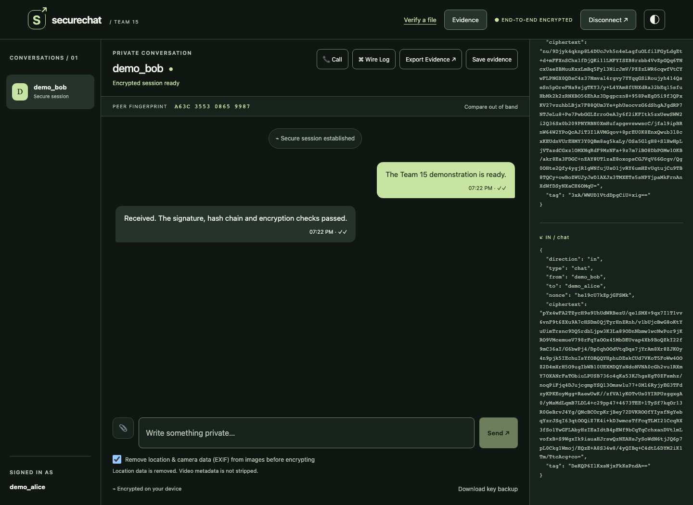

# Team 15 Secure Chat

A university Cryptography & Network Security project: an end-to-end encrypted,
auditable messenger with a browser client, a local Tkinter client, and a separate
hostile-relay Attack Lab. Each message is signed and hash-chained so exported
conversations can be checked independently. This intentionally preserves signed
records rather than offering deniable messaging.

## Live deployment

- **Chat:** [team15-securechat.onrender.com](https://team15-securechat.onrender.com)
- **Attack Lab:** [team15-attack-lab.onrender.com](https://team15-attack-lab.onrender.com)
- **Public verifier:** [Verify a file](https://team15-securechat.onrender.com/verify)

Both Render services use Free plans in Singapore, one process/instance each;
main persistence uses Neon Free Postgres and private Object Storage. TURN uses
Metered’s free trial allowance. Services can sleep: open them about two minutes
before a demonstration. No uptime pinger is deployed. Lab entry requires the
operator’s access code; its accounts, database and roster are separate from chat.
See [deployment instructions](docs/DEPLOY.md) and [final report](docs/reports/final_report.md).



## Features

- Two-party chat in React/TypeScript or Python/Tkinter; byte-compatible cryptography
  across WebSocket and local TLS/TCP transports.
- Password-wrapped browser identities, portable encrypted key backups, peer RSA
  fingerprints, per-message security receipts and a redacted ciphertext Wire Log.
- Signed evidence v1/v2, Ed25519 server receipts, password-encrypted evidence vault,
  local PDF reports and an upload-free public verification page.
- Encrypted images and video, including QuickTime MOV, authenticated chunked files,
  image EXIF removal, verified downloads and codec-dependent inline playback.
- One-to-one WebRTC voice: encrypted/signed signaling, DTLS certificate checks,
  four verification words, mute, call records and short-lived TURN credentials.
  Simultaneous calls resolve to the smaller username’s outgoing call; the other
  party still accepts explicitly.
- Shared light/dark design, mobile layouts, keyboard focus, modal focus restoration,
  reduced-motion support and automated WCAG AA checks on the main flows and console.
- Separate Attack Lab: ciphertext tampering, replay, deletion/reordering, forgery,
  handshake substitution, sandbox lockout, attachment attacks and call checks.
  Victims receive the same production client bundle.

## Architecture


[Architecture and server visibility](docs/architecture.md) ·
[Mermaid source](docs/architecture.mmd) · [Zoomable SVG](docs/architecture_diagram.svg)

`web/` and `server/server.py` adapt HTTPS/WSS and local TLS/TCP to one
`server/relay_core.py`. `crypto_engine/` and browser crypto run at the endpoints.
`server/db.py` owns SQL persistence. The separate `attack_lab/` imports the relay’s
neutral extension point; production has no attack controls or lab routes.

## Security properties

| Property | Mechanism and practical boundary |
|---|---|
| Content confidentiality | AES-256-GCM with client-held session keys; relay/storage retain ciphertext, never chat/file plaintext or session/private keys |
| Authenticated session setup | RSA-2048 PSS signatures over ephemeral X25519; HKDF derives session material; compare RSA fingerprints independently |
| Message authenticity | RSA-PSS SHA-256/MGF1-SHA256, existing 222-byte maximum salt; sender-signed canonical records |
| Tamper/deletion evidence | AES-GCM tags, signatures, directional SHA-256 chains, signed final heads; a gap is detected when later evidence exposes it |
| Replay resistance | Signed timestamps, freshness window and per-sender nonce tracking |
| Transport | TLS for desktop; HTTPS/WSS, exact Origins, CSP/HSTS and explicit proxy trust in production |
| Password defense | Existing PBKDF2-SHA256 (200,000 iterations), random salt, DB-backed sliding-window locks checked before PBKDF2; separate source-rate limits |
| Evidence integrity | Independent Python/browser verification; exporter signature; optional server digest/time/corroboration receipt |
| Vault confidentiality | PBKDF2-SHA256 (600,000 iterations), purpose-separated salt, AES-256-GCM before upload; owner-filtered API |
| Media confidentiality | Fresh per-file key, 1 MiB AES-GCM chunks; hashes checked before opening; descriptor inside signed encrypted chat |
| Call authentication | Signed encrypted SDP, real remote DTLS fingerprint comparison and four-word confirmation; DTLS-SRTP audio |
| Attack Lab containment | Separate site/process/origin/DB/roster, access-code session gate and rate limits; unchanged production victims |

Authentication passwords are visible transiently to the TLS endpoint during login
and registration; only PBKDF2 hashes persist. The server also sees usernames, IPs,
routing/timing/sizes, public handshake fields, ciphertext, evidence titles/hashes
and receipts, and attachment ownership/size/expiry metadata. TURN sees peer IPs and
encrypted media traffic. [The architecture](docs/architecture.md) lists stored fields.

## Run locally

Use Python 3.12 and a supported current Node.js (Vite requires Node 20.19+ or 22.12+).
Tkinter must be available for the desktop client; browser-only use needs no Tk.
From the repository root:

```sh
python3 -m venv .venv
.venv/bin/python -m pip install -r requirements-dev.txt
npm --prefix web/frontend ci
npm --prefix web/frontend run setup:lint
npm --prefix web/frontend run build
npm --prefix web/frontend run build:lab
.venv/bin/python tools/check_static_assets.py
.venv/bin/python -m web
```

Open the printed localhost URL in two separate browser profiles. Create an identity
in each, enter the other username as peer, and wait for **Secure session established**.
Compare fingerprints independently. Download wrapped key backups before clearing
browser storage. Existing identities use **Log in**; registering the same username
again is rejected. A lost identity/password has no recovery service.

For a combined desktop/browser roster or the macOS demo launcher:

```sh
.venv/bin/python certs/generate_certs.py
.venv/bin/python server/server.py --port 5055 --web-port 8080
demo/start_demo.sh --web --port 5055
# Stop the macOS launcher:
demo/stop_demo.sh
```

The desktop client pins the local certificate. If a deliberately regenerated
certificate no longer matches a saved pin, verify its fingerprint independently
before resetting that pin. Do not bypass TLS verification.

## Database

Local startup creates `data/securechat.db`; `DATABASE_URL` overrides it. Production
uses a TLS-required `postgresql+psycopg://` URL. SQLite and Postgres share SQLAlchemy
2.x definitions and explicit additive migrations 1→2→3. Future unsupported versions
fail startup. Schema version **3** is separate from evidence format versions.

| Table | Columns |
|---|---|
| `users` | `username` PK, `password_hash`, `public_key_pem`, `created_at` |
| `login_lockouts` | `username` PK, `failure_count`, `locked_until`, `last_failure_at`, `lock_level`, `failure_timestamps` JSON |
| `security_events` | `id` PK, `ts`, `event_type`, `username`, `peer_addr`, `details` JSON, unique `import_key` |
| `relayed_envelopes` | `id` PK, `ts`, `sender`, `recipient`, `envelope_type`, `size_bytes`, `ciphertext_b64`, indexed `envelope_sha256` |
| `evidence_bundles` | `id` PK, indexed `owner`, `created_at`, `title`, `size_bytes`, `file_sha256`, `ciphertext_b64`, `timestamp_receipt` JSON |
| `attachments` | `id` PK, `uploader`, `recipient`, unique `object_key`, `kind`, `ciphertext_size`, `ciphertext_sha256`, `created_at`, `finalized_at`, `expires_at`, `deleted_at` |
| `schema_version` | `version` PK, currently `3` |

Relay capture defaults on; `SECURECHAT_STORE_ENVELOPES=0` disables it and
`SECURECHAT_ENVELOPE_MAX_ROWS` bounds rows (default 10,000). Large ciphertext is not
duplicated in the bounded relay audit field. JSONL security events remain available
to the read-only Tkinter dashboard. Legacy import is idempotent:

```sh
.venv/bin/python tools/migrate_json_to_db.py
```

No manual schema SQL is needed on startup. Back up before upgrading. Never run
integration tests against the main DB: use the isolated schema/disposable Neon
command and URL guard in [DEPLOY.md section 3](docs/DEPLOY.md#3-create-neon-main-and-disposable-test-databases).

## Evidence

Export the signed JSON from chat, or choose **Save evidence**, enter the password
again, and encrypt it into the private vault. Unlock a saved entry to verify or
download the exact JSON, receipt and public TSA key. The PDF is an unsigned reading
companion; **the original signed JSON is authoritative**. `/verify` checks files
entirely in the browser without uploading them.

```sh
.venv/bin/python tools/verify_transcript.py evidence.json
.venv/bin/python tools/verify_transcript.py evidence.json \
  --receipt receipt.json --tsa-pubkey tsa-public.pem
```

V1 remains valid; v2 adds canonical ciphertext-envelope hashes covered by the
exporter’s signature. Attachment/call records use those existing formats; there is
no evidence/v3 format. Keep the exact bytes for the receipt, which signs their
SHA-256, server UTC clock and retained-envelope corroboration count.

A receipt cannot prove that a ciphertext encodes the claimed plaintext. Keys must
be independently trusted; signatures do not establish a person’s legal identity
or the truth/completeness of a conversation. Legal admissibility in India may also
need a Section 63 certificate under the Bharatiya Sakshya Adhiniyam, 2023. The app
provides technical integrity checks, not legal certification. Formats, crypto
parameters and proof limits are detailed in [docs/evidence.md](docs/evidence.md).

## Media and calls

Images: JPEG/PNG/WebP/GIF, default 10 MiB. Videos: MP4/WebM/QuickTime MOV, default
50 MiB. Files are encrypted locally before storage; names/keys/thumbnails are inside
the signed encrypted descriptor. Image EXIF removal is enabled by default; video
metadata is not stripped. Unsupported MOV codecs offer verified download. Desktop
clients preserve the descriptor for verification but show a web-only placeholder.

Calls need HTTPS (localhost is the development exception), microphone permission and
an online peer. Compare the four words and confirm them on both screens. The
fingerprint must match the signed SDP before **Call verified**. `/?relay=1` forces
TURN; otherwise direct connectivity is preferred. Metered credentials can take
about a minute to become usable. No TURN secret is exposed to the browser or lab.

## Simple Mallory demo

`demo/start_demo.sh --mallory [--lan]` is the easiest live attack demo: Alice and Bob chat in the web client, and
Mallory's window shows each message as ciphertext with three buttons, **DROP**, **TAMPER**, **REPLAY**. The next
message gets the treatment and the receiver's own checks report it (message missing, altered, duplicate). With
`--lan` Bob is your phone. Script: [attack_lab/README.md](attack_lab/README.md#simple-mallory-demo-message-level).

## Network attacker demo

`demo/start_demo.sh --network-attack` starts the real web gateway over HTTPS/WSS, a
TLS-blind man-in-the-middle proxy (`attack_lab/netproxy`, no TLS key), Mallory's window
(`http://localhost:8095`) and two Chrome windows (Alice, Bob) on the proxied URL, with an
automatically generated local certificate. `--desktop` runs it with the Tkinter clients; `--lan` lets
a phone on the same Wi-Fi (or the Mac on the phone's hotspot) be a victim, with a QR code and a page
for installing the demo CA. Mallory sees only ciphertext records and can Forward, Alter, Drop, Replay or
Delay them; the failures that follow (`bad record mac`, stalls) are produced by the
real TLS stacks. Step-by-step script, browser (HTTPS/WSS) use and limits:
[attack_lab/README.md](attack_lab/README.md#network-attacker-demo-fake-wi-fi).

## Running the Attack Lab

```sh
.venv/bin/python -m attack_lab
# macOS launcher, optional local TCP listener:
demo/start_demo.sh --lab
```

Use the printed sandbox URL (port from `PORT` or `--port`). Production additionally
requires the private access code. Start/reset a session, connect victims, arm an
attack and send a message. The console separates attempted actions from reports
produced by real client checks. The media-certificate case simulates the observed
certificate in the lab; it is labeled and is not a live network MITM. Other relay
attacks operate on real envelopes. [Lab guide](attack_lab/README.md).

Compatibility wrappers remain in `demo/run_*_demo.py` because docs/tests still use
them; implementations live in `attack_lab/scripts/`. Each uses temporary sandbox
state. Tamper, replay, MITM, drop, evidence and Wireshark demos are documented in
[demo/README.md](demo/README.md). The former in-app panel/walkthrough/screenshots are
explicitly [historical](docs/history/full_walkthrough.md).

## Tests and quality checks

```sh
.venv/bin/python -m pytest tests/ -q
.venv/bin/python -m ruff check .
.venv/bin/python -m ruff format --check .
npm --prefix web/frontend run lint
npm --prefix web/frontend run format:check
npm --prefix web/frontend run typecheck
npm --prefix web/frontend test
npm --prefix web/frontend exec -- playwright install chromium webkit
npm --prefix web/frontend run test:e2e -- --project=chromium --project=webkit
npm --prefix web/frontend run test:lab -- --project=chromium --project=webkit
npm --prefix web/frontend run test:netattack   # browser network-attacker demo (Chromium)
npm --prefix web/frontend run test:mallory     # simple Mallory demo (Chromium + WebKit)
.venv/bin/python tools/evaluate_security.py
.venv/bin/python -m pip_audit -r requirements-dev.txt
npm --prefix web/frontend audit
npm --prefix web/frontend/lint audit
```

Run native GUI pytest separately from browser suites on macOS, since they share
keyboard focus. ESLint’s isolated pinned parser uses TypeScript 6; the application
still builds/types with pinned TypeScript 7. The Starlette test adapter uses httpx2
and no longer emits the deprecated-httpx warning.

Current local results: **496 pytest passed / 2 opt-in Postgres skips** (24 network-attacker and 8 Mallory tests), **85 disposable
Neon tests passed**, **84 Vitest passed**, **43 main browser tests passed / 7 skips**
and **26 lab browser tests passed / 4 skips** (Chromium + WebKit). Live results:
**42 main passed / 8 skips**, **26 lab passed / 4 skips**, including a real
TURN-relayed call. The evaluator
detected **120/120 attacks**, with **0/200 false rejections**.

Measured baselines and live totals appear in [the final report](docs/reports/final_report.md).
[Security evaluation](docs/evaluation_results.md) runs the real clients/relay, with
120 attack trials and 200 normal messages. [Current screenshots](docs/screenshots/README.md)
use local throwaway users, including valid/tampered evidence and verified calls.

## Known limitations

- This course implementation has not received an independent professional security
  audit. Endpoint compromise, malicious browser JavaScript/extensions and XSS can
  expose unlocked content. TLS-hosted JavaScript is part of the trust boundary.
- Server login passwords are visible transiently; browser vault/identity encryption
  permits offline guessing if a wrapped copy is stolen. Use strong passwords.
- Desktop private-key PEM files are local and unencrypted. Browser identities are
  password-wrapped at rest. Back up privately; no account/key recovery exists.
- There is no offline queue, group chat, key transparency, double ratchet, password
  change flow or synchronized history. Fresh sessions use ephemeral keys, but there
  is no per-message ratchet. Exports deliberately preserve signed content.
- A malicious relay can deny service or suppress a final message without a later
  message exposing the gap. Directional chains do not prove cross-direction order.
- The SQL store exposes metadata, evidence titles and digests; provider backups may
  outlive deletion. Secure deletion and provider retention are outside app control.
- Evidence can contain sensitive text, descriptors/keys and call network addresses.
  Keep exports confidential; pin participant/TSA public keys independently.
- One worker/instance only: rosters, source rate limits, HTTP tokens and lab sessions
  are in memory. Account locks persist; free-service restarts interrupt calls/chats
  and erase lab state. Free hours, storage/egress and TURN trial quota are limited.
- Automated WebKit call-media tests lack a fake microphone; Firefox’s Playwright
  build cannot launch on this Mac. MOV acceptance does not guarantee codec playback.
  Automated accessibility checks support, but do not constitute, a full WCAG audit.
- Render’s initial platform loading page precedes the app; the app can explain a
  WebSocket cold start only after its JavaScript has loaded.

## Project map and credits

`client/`, `gui/`, `auth/`, `crypto_engine/`, `server/`, `web/`, `attack_lab/`,
`tests/`, `demo/`, `tools/` and `docs/` hold the implementation and reproducible checks.
[Phase reports](docs/reports/README.md) retain measured history; old PDF/PowerPoint
submission artifacts are unchanged and may show earlier UI.

Developed by **Team 15** for the university Cryptography & Network Security course.
Python cryptography/PyCryptodome, SQLAlchemy, FastAPI/Uvicorn, React, WebCrypto,
WebRTC, pdf-lib/fontkit, Noto fonts (SIL OFL), node-forge and the test/lint ecosystem
provide the underlying libraries. The design and documentation distinguish measured
checks from trust assumptions and unverified deployment/browser behavior.
