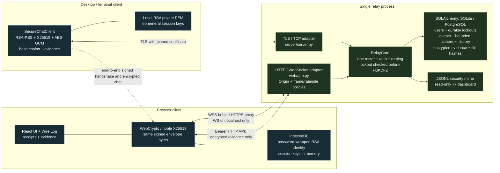

# Architecture

## Overview

Python clients use the TLS/TCP adapter in `server/server.py`; browser clients use
`web/app.py` (FastAPI HTTP/WebSocket). Both enter `server/relay_core.py`, sharing one
locked roster, authentication policy, lockout guard and SQL database. JSON-line TCP
messages and one-JSON-object WebSocket frames carry the same envelopes. The server
continues to relay opaque chat ciphertext and public handshake values.

`python server/server.py --web-port 8080` runs both adapters in one process.
`python -m web` runs only HTTP/WS and imports no TCP adapter or lab implementation.
HTTPS/WSS must be supplied by a trusted reverse proxy in deployment; localhost HTTP
is for development. Browser keys/crypto run in the frontend, never in the gateway.

A high-resolution version is also at [`architecture_diagram.png`](architecture_diagram.png)
and as a zoomable vector at [`architecture_diagram.svg`](architecture_diagram.svg).

Mermaid source (for future edits — re-render with `npx @mermaid-js/mermaid-cli`)

## Transport and threading boundary

The shared core sends structured envelopes through transport adapters. The TCP adapter
serializes newline-delimited JSON to `LockedTLSSocket`; WebSocket peers schedule a
bounded outbox on the asyncio event loop with `call_soon_threadsafe`. The gateway
invokes synchronous core/PBKDF2/SQL operations through `asyncio.to_thread`, so it never
blocks its event loop or waits for that loop while holding a roster lock. Each browser
serializes asynchronous crypto operations to preserve handshake/message ordering.

The gateway checks an exact Origin allowlist, UTF-8 frame size, connection rate and
idle timeout, and rejects binary/unknown types. CSP allows same-origin external assets
without inline scripts. The web path rejects lab controls even in shared local demo
mode. The standalone web entry point never imports lab code. The roster remains
process-local; multiple deployment workers are not supported.

## Evidence, receipts and vault boundary

The browser exports v2 evidence including an exporter-signed canonical ciphertext
hash per verified message; Python preserves v1 default exports and supports v2.
The browser encrypts exact JSON file bytes before authenticated upload. An in-memory
bearer token issued by WebSocket login authorizes owner-filtered HTTP vault operations;
it is never written to the DB or Wire Log and is revoked at disconnect.

The server sees a plaintext-file digest, encrypted package, owner/title/size/time and
submitted envelope hash manifest. It signs UTC clock receipts with a **separate
Ed25519 key**, exposed publicly at `/api/timestamp-key`. It counts retained matching
chat-envelope hashes for that owner without decrypting evidence. It cannot verify
that the encrypted file contains the claimed manifest or bind ciphertext to claimed
plaintext. Receipts attest server observations and clock, not legal identity or truth.

`/verify` performs local v1/v2 and optional receipt verification with no file upload.
The browser PDF is a local unsigned companion; the signed JSON remains authoritative.
See [evidence.md](evidence.md) for cryptographic formats, limitations and India Section
63 certificate requirements. The database now also stores `evidence_bundles` and
schema v2 preserves old data transactionally.

## What the server CAN see

These values now also feed the SQL persistence described under
[What the server stores](#what-the-server-stores); no end-to-end decryption is added.

- Evidence file SHA-256 values, encrypted vault containers, titles, sizes, owners,
  UTC receipt metadata and submitted ciphertext hash manifests. No evidence plaintext
  or vault decryption keys reach it.
- Usernames and the routing metadata of every envelope (who is talking to whom, and
  when — it decides delivery by the `to` field).
- Each user's PBKDF2 password *hash* (never the plaintext password — see
  `auth/password_hash.py`) and RSA *public* key (`server/user_store.py`), both
  submitted once at registration.
- Opaque ECDH public keys during the handshake, and opaque AES-GCM ciphertext/tag for
  every chat message — bytes it can relay but not read, since it never holds the
  session key.
- The plaintext of the register/login envelope as JSON after TLS/WSS terminates — i.e. the server, as the TLS endpoint, necessarily decrypts the connection
  to read routing envelopes (or receives them from its trusted HTTPS proxy). This is why the AES-GCM/RSA layer for chat *content*
  matters even though TLS is also present: TLS protects data in transit to the server,
  not from the server itself. A password is the one piece of data that has no
  additional application-layer protection beyond TLS — see "Known limitations" in the
  main [README.md](../README.md).

## What the server stores

`server/db.py` creates or upgrades to schema v2 on startup, selected by `DATABASE_URL` (default:
`data/securechat.db`; PostgreSQL uses `postgresql+psycopg://...`). The shared SQLAlchemy
Core schema and transaction adapter can be reused by later transports without changing
client cryptography. See [Database](../README.md#database) for the full column schema,
configuration, migration commands and versioning policy.

- `users`: the existing PBKDF2 encoded hashes, RSA public PEM keys, usernames and
  account creation timestamps. Legacy JSON imports preserve hashes exactly.
- `login_lockouts`: failure counts, exact sliding-window failure timestamps, most
  recent failure time, lock expiry and backoff tier. Restarting preserves locks, and
  the relay still checks lock status **before PBKDF2**. Source-address limits remain
  in memory.
- `security_events`: timestamps, event types, usernames, peer addresses and structured
  metadata in JSON, plus an import identity for idempotent legacy migration. The JSONL
  mirror remains the read-only dashboard's source; SQL and file writes are separate.
- `relayed_envelopes`: indexed canonical envelope SHA-256 plus a bounded audit history of online chat/handshake forwarding,
  containing time, sender, recipient, type and byte size, plus only the chat's opaque
  base64 ciphertext. Handshake rows contain no ciphertext; their public key/signature
  payloads are not archived. Unknown extra fields are never serialized into SQL.
  Capture defaults on, can be disabled with `SECURECHAT_STORE_ENVELOPES=0`, and has a
  `SECURECHAT_ENVELOPE_MAX_ROWS` cap (default 10000), pruned on each insert.
- `evidence_bundles`: owner-only password-encrypted evidence containers, title, creation
  time, encrypted size, plaintext-file SHA-256 and signed timestamp receipt JSON.
- `schema_version`: schema version `2`, with an explicit additive 1→2 migration.
  Historical relay hashes are NULL; missing nonce/tag fields cannot be backfilled.
  Startup rejects unsupported versions;
  future table alterations require an explicit versioned migration.

These stored fields are part of **what the server CAN see**: a database reader can
learn account and traffic metadata and retain ciphertext, but has no chat decryption
keys. `tests/test_database.py` sends a unique message through two real TLS clients,
confirms the recipient receives it, and scans every table/column for its plaintext.
The database does not provide message delivery, encrypted media or another transport.

## What the server CANNOT see (by design, verified in `tests/`)

- The plaintext of any chat message, ever — only AES-256-GCM ciphertext
  (`tests/test_aes_gcm.py`, `tests/test_tls_setup.py`).
- Either side's ECDH private key, or the derived AES-256 session key
  (`crypto_engine/dh_exchange.py`; the private key is deleted from memory immediately
  after use, never serialized, never sent).
- Either side's RSA private key — the browser keeps a password-wrapped PKCS8 identity
  in IndexedDB/backups and uses a non-extractable runtime signing key; only the public
  key is submitted at registration
  (`auth/keystore.py`, `crypto_engine/signatures.py`).
- A user's plaintext password — only its PBKDF2 hash is ever persisted
  (`auth/password_hash.py`; `tests/test_password_hash.py::test_hash_does_not_contain_plaintext_password`).

## Threat model this maps to

| Attacker position | What stops them | Where |
|---|---|---|
| On the network, between a client and the server | TLS (Phase 6) — connection is opaque | `certs/`, `connect_tls()` in `client/client.py` |
| Controls/compromises the relay server itself | AES-256-GCM (content), RSA-PSS (handshake + message authenticity) — the server never holds the keys needed to read or forge either | `crypto_engine/aes_gcm.py`, `crypto_engine/signatures.py` |
| Captures a valid envelope and resends it later | Signed timestamp + freshness window + per-sender nonce tracking (Phase 7b) | `client/client.py`'s `is_timestamp_fresh`, `_seen_nonces` |
| Tries to brute-force a captured password hash | PBKDF2, 200,000+ iterations, per-user random salt | `auth/password_hash.py` |

See the main [README.md](../README.md) for the full wire protocol, the live demo
scripts that exercise each of these rows against the real code, and the honest list of
what's *not* covered by this threat model.
