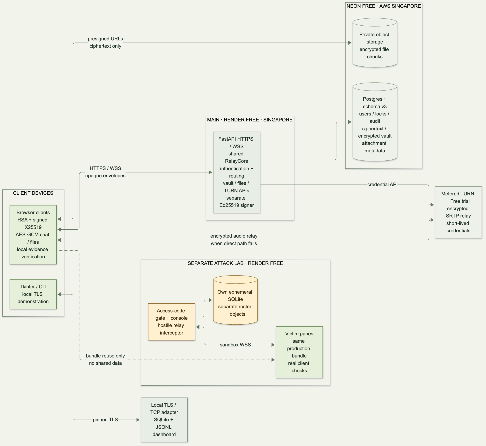
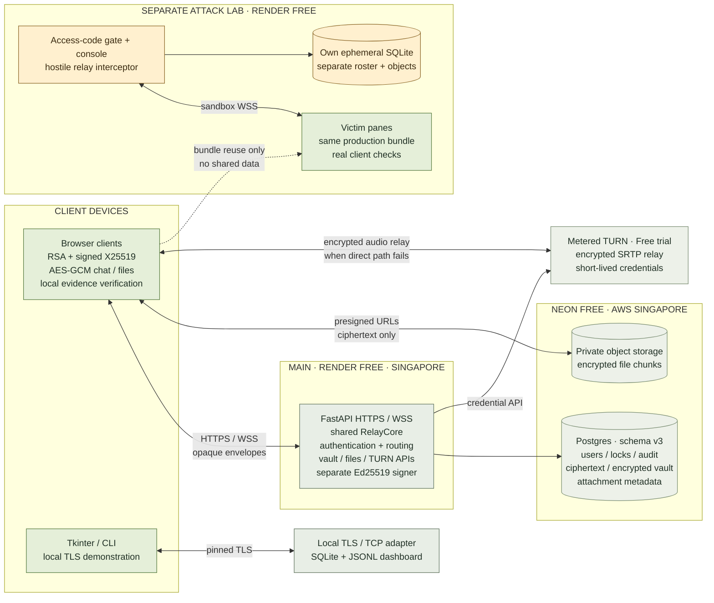

# Architecture

## Overview

Python clients use the TLS/TCP adapter in `server/server.py`; browser clients use
`web/app.py` (FastAPI HTTP/WebSocket). Both enter `server/relay_core.py`, sharing one
locked roster, authentication policy, lockout guard and SQL database. JSON-line TCP
messages and one-JSON-object WebSocket frames carry the same envelopes. The server
continues to relay opaque chat ciphertext and public handshake values.

`python server/server.py --web-port 8080` runs both adapters in one process.
`python -m web` runs only HTTP/WS and imports no TCP adapter or lab implementation.
Production mode requires HTTPS/WSS behind an explicitly trusted reverse proxy,
stable environment TSA material, main Postgres and explicit origins. `/healthz`
checks DB connectivity. Proxy headers are accepted only from configured ingress
addresses/networks, and direct insecure requests are denied. Localhost HTTP
is for development. Browser keys/crypto run in the frontend, never in the gateway.

The live main and lab services run separately on Render Free in Singapore, with
main state in Neon Free Postgres (AWS Singapore) and lab state in its own ephemeral
SQLite database. Forwarding trust uses owner-approved loopback, 10.0.0.0/8 and the
complete Cloudflare IPv4/IPv6 lists fetched on 17 November 2026; other private
ranges are excluded. [DEPLOY.md section 6](DEPLOY.md#6-verify-the-trusted-proxy-boundary-before-using-logins)
records the exact configuration, authoritative sources and refresh requirement.
The direct socket peer is loopback, with additional Render/private and Cloudflare
hops in the forwarding chain. Live Mac/phone checks confirm distinct normalized
client IPs and rejection of a client-supplied spoofed X-Forwarded-For value.

A high-resolution version is also at [`architecture_diagram.png`](architecture_diagram.png)
and as a zoomable vector at [`architecture_diagram.svg`](architecture_diagram.svg).

Mermaid source (for future edits — re-render with `npx @mermaid-js/mermaid-cli`)

## Transport and threading boundary

The shared core sends structured envelopes through transport adapters. The TCP adapter
serializes newline-delimited JSON to `LockedTLSSocket`; WebSocket peers schedule a
bounded outbox on the asyncio event loop with `call_soon_threadsafe`. The gateway
invokes synchronous core/PBKDF2/SQL operations through `asyncio.to_thread`, so it never
blocks its event loop or waits for that loop while holding a roster lock. Each browser
serializes asynchronous crypto operations to preserve handshake/message ordering.

The gateway checks an exact Origin allowlist, UTF-8 frame size, connection rate and
idle timeout, and rejects binary/unknown types. CSP allows same-origin external assets
without inline scripts. Both production adapters reject and log unknown envelope types, including lab controls.
Neither production entry point imports lab code. The roster remains
process-local; multiple deployment workers are not supported.

## Separate Attack Lab boundary

`python -m attack_lab` is a separate FastAPI site and hostile relay process. It imports
the real adapters/core and supplies the core's one optional neutral interceptor.
Production constructs that core with `interceptor=None`; it contains no attack flags,
control handlers or lab UI. The dependency points from lab to product only.

Two sandbox iframes serve byte-identical production HTML/JS at `/victim`; the controller
fills the real login/composer forms. It never patches client crypto or detection code.
A separate Vite entry builds only the console; this keeps its control code out of the
production bundle. The console sees allowlisted public envelope fields and ciphertext,
and displays real clients' reports. TLS TCP is optional and bound to localhost.

The lab uses an explicitly supplied `DatabaseUserStore`, `LockoutGuard` and logger,
`LAB_DATABASE_URL` and its own roster. It never assigns `DATABASE_URL`. Database alias
checks reject the production DB (including SQLite symlinks/hardlinks and URI aliases).
Operator configuration must still provide separate PostgreSQL credentials/databases;
the sandbox is not a boundary against a malicious administrator changing source code.
Lab origin allowlists are disjoint, control writes require Origin and a lab session,
and read/write limits are separate. Reset deletes only sandbox rows and reseeds the
victims and fixed lockout account. Sessions/rate limits/roster are process-local.

## Evidence, receipts and vault boundary

The browser exports v2 evidence including an exporter-signed canonical ciphertext
hash per verified message; Python preserves v1 default exports and supports v2.
The browser encrypts exact JSON file bytes before authenticated upload. An in-memory
bearer token issued by WebSocket login authorizes owner-filtered HTTP vault operations;
it is never written to the DB or Wire Log and is revoked at disconnect.

The server sees a plaintext-file digest, encrypted package, owner/title/size/time and
submitted envelope hash manifest. It signs UTC clock receipts with a **separate
Ed25519 key**, exposed publicly at `/api/timestamp-key`. It counts retained matching
chat-envelope hashes for that owner without decrypting evidence. It cannot verify
that the encrypted file contains the claimed manifest or bind ciphertext to claimed
plaintext. Receipts attest server observations and clock, not legal identity or truth.

`/verify` performs local v1/v2 and optional receipt verification with no file upload.
The browser PDF is a local unsigned companion; the signed JSON remains authoritative.
See [evidence.md](evidence.md) for cryptographic formats, limitations and India Section
63 certificate requirements. The database now also stores `evidence_bundles` and
the current schema v3 preserves old data through explicit additive upgrades.

## Attachments (schema v3)

`web/attachments_api.py` authorises presigned object URLs; `server/storage.py` has a
`local` backend (dev/tests/lab, HMAC-signed same-origin URLs) and an `s3` backend
(stdlib SigV4 against Neon Object Storage; presigned PUT signs `content-length`, so
the bucket itself rejects a different size). Flow: `POST /api/attachments` (id,
recipient, kind, ciphertext size/hash → quota, limits, rate limit, presigned PUT) →
browser PUT of ciphertext → `POST .../finalize` (HEAD size check; otherwise the
object is discarded) → recipient `GET .../download` (only uploader/recipient; the
same 404 for strangers, expired and unfinalised ids) → presigned GET. The `attachments`
table holds id, uploader, recipient, kind, object key, ciphertext size/hash and
timestamps; never names, MIME types, keys or thumbnails. Expiry is lazy: each
upload sweeps up to 25 expired/orphaned objects. CSP adds `img-src blob:`,
`media-src blob:` and the bucket origin to `connect-src`. The attachment descriptor
is plaintext *inside* the E2E message, so evidence v2 and the hash chain cover it
unchanged; no evidence format change was needed (v1/v2 files still verify).

## Voice calls

`web/frontend/src/calls/` holds the call stack. `signal.ts` defines the call messages (the
text of normal chat messages, so the existing signature, AES-GCM, chain and replay checks
apply; `Session.receiveChat` routes only *verified* signals to `CallManager`). `sdp.ts`
validates audio-only SDP and extracts the single SHA-256 DTLS fingerprint; `manager.ts` runs
the state machine (idle/calling/ringing/connecting/active, 30 s ring timeout, one call at a
time, deterministic simultaneous-call resolution) and polls `getStats` for the connection type, quality and the real remote
certificate fingerprint; `sas.ts` derives the four spoken words from both fingerprints and the
call id. `web/calls_api.py` serves `/api/calls/ice` (STUN list plus short-lived TURN
credentials created with the Metered REST API; secret key server-side only, TTL capped at 600 s,
10 requests/minute/user, graceful STUN-only fallback). `Permissions-Policy` allows `microphone`
for this origin only. Call records are signed chat events, so evidence v1/v2 verify unchanged.
The relay can delay, drop or replay call messages but cannot read or alter them; it cannot see
media, which is peer to peer (or encrypted SRTP via TURN).

## What the server CAN see

These values now also feed the SQL persistence described under
[What the server stores](#what-the-server-stores); no end-to-end decryption is added.

- Evidence file SHA-256 values, encrypted vault containers, titles, sizes, owners,
  UTC receipt metadata and submitted ciphertext hash manifests. No evidence plaintext
  or vault decryption keys reach it.
- Usernames and the routing metadata of every envelope (who is talking to whom, and
  when — it decides delivery by the `to` field).
- The registration/login password transiently inside TLS-terminated authentication
  envelopes. Only its PBKDF2 hash is persisted; the relay also stores the RSA public
  key submitted at registration (`auth/password_hash.py`, `server/user_store.py`).
- Attachment metadata: uploader, recipient, image/video kind, ciphertext size, ciphertext
  SHA-256, upload/expiry times, plus the bucket's access logs. Never file names, types,
  keys, thumbnails or content.
- Call metadata: that two users exchanged encrypted call signaling (timing and size), and a
  TURN provider (if used) sees IP addresses and encrypted SRTP volume. Never call audio, SDP or
  fingerprints.
- Opaque ECDH public keys during the handshake, and opaque AES-GCM ciphertext/tag for
  every chat message — bytes it can relay but not read, since it never holds the
  session key.
- The plaintext of the register/login envelope as JSON after TLS/WSS terminates — i.e. the server, as the TLS endpoint, necessarily decrypts the connection
  to read routing envelopes (or receives them from its trusted HTTPS proxy). This is why the AES-GCM/RSA layer for chat *content*
  matters even though TLS is also present: TLS protects data in transit to the server,
  not from the server itself. A password is the one piece of data that has no
  additional application-layer protection beyond TLS — see "Known limitations" in the
  main [README.md](../README.md).

## What the server stores

`server/db.py` creates or upgrades to schema v3 on startup, selected by `DATABASE_URL` (default:
`data/securechat.db`; PostgreSQL uses `postgresql+psycopg://...`). The shared SQLAlchemy
Core schema and transaction adapter can be reused by later transports without changing
client cryptography. See [Database](../README.md#database) for the full column schema,
configuration, migration commands and versioning policy.

- `users`: the existing PBKDF2 encoded hashes, RSA public PEM keys, usernames and
  account creation timestamps. Legacy JSON imports preserve hashes exactly.
- `login_lockouts`: failure counts, exact sliding-window failure timestamps, most
  recent failure time, lock expiry and backoff tier. Restarting preserves locks, and
  the relay still checks lock status **before PBKDF2**. Source-address limits remain
  in memory.
- `security_events`: timestamps, event types, usernames, peer addresses and structured
  metadata in JSON, plus an import identity for idempotent legacy migration. The JSONL
  mirror remains the read-only dashboard's source; SQL and file writes are separate.
- `relayed_envelopes`: indexed canonical envelope SHA-256 plus a bounded audit history of online chat/handshake forwarding,
  containing time, sender, recipient, type and byte size, plus only the chat's opaque
  base64 ciphertext. Handshake rows contain no ciphertext; their public key/signature
  payloads are not archived. Unknown extra fields are never serialized into SQL.
  Capture defaults on, can be disabled with `SECURECHAT_STORE_ENVELOPES=0`, and has a
  `SECURECHAT_ENVELOPE_MAX_ROWS` cap (default 10000), pruned on each insert.
- `evidence_bundles`: owner-only password-encrypted evidence containers, title, creation
  time, encrypted size, plaintext-file SHA-256 and signed timestamp receipt JSON.
- `attachments`: see above. `schema_version`: schema version `3`, with explicit additive
  1→2 and 2→3 migrations (run in one transaction/advisory lock).
  Historical relay hashes are NULL; missing nonce/tag fields cannot be backfilled.
  Startup rejects unsupported versions;
  future table alterations require an explicit versioned migration.

These stored fields are part of **what the server CAN see**: a database reader can
learn account and traffic metadata and retain ciphertext, but has no chat decryption
keys. `tests/test_database.py` sends a unique message through two real TLS clients,
confirms the recipient receives it, and scans every table/column for its plaintext.
The database records metadata and encrypted artifacts; delivery remains the relay’s job.

## What the server CANNOT see (by design, verified in `tests/`)

- The plaintext of any chat message, ever — only AES-256-GCM ciphertext
  (`tests/test_aes_gcm.py`, `tests/test_tls_setup.py`).
- Either side's ECDH private key, or the derived AES-256 session key
  (`crypto_engine/dh_exchange.py`; the private key is deleted from memory immediately
  after use, never serialized, never sent).
- Either side's RSA private key — the browser keeps a password-wrapped PKCS8 identity
  in IndexedDB/backups and uses a native non-extractable runtime signing key (WebKit uses a client-local forge RSA-PSS
  fallback when native 222-byte salt signing is unavailable); only the public
  key is submitted at registration
  (`auth/keystore.py`, `crypto_engine/signatures.py`).
Authentication passwords are visible transiently to the TLS endpoint, unlike chat
content. They are never persisted as plaintext; only PBKDF2 hashes are stored
(`auth/password_hash.py`).

## Threat model this maps to

| Attacker position | What stops them | Where |
|---|---|---|
| On the network, between a client and the server | TLS (Phase 6) — connection is opaque | `certs/`, `connect_tls()` in `client/client.py` |
| Controls/compromises the relay server itself | AES-256-GCM (content), RSA-PSS (handshake + message authenticity) — the server never holds the keys needed to read or forge either | `crypto_engine/aes_gcm.py`, `crypto_engine/signatures.py` |
| Captures a valid envelope and resends it later | Signed timestamp + freshness window + per-sender nonce tracking (Phase 7b) | `client/client.py`'s `is_timestamp_fresh`, `_seen_nonces` |
| Tries to brute-force a captured password hash | PBKDF2, 200,000+ iterations, per-user random salt | `auth/password_hash.py` |

See the main [README.md](../README.md) for the full wire protocol, the live demo
scripts that exercise each of these rows against the real code, and the honest list of
what's *not* covered by this threat model.

## Render/Neon deployment boundary

See [DEPLOY.md](DEPLOY.md). Two independent free Python services run one process
each. Main uses Neon through normalized psycopg URLs with TLS and a small recyclable
pool. Its Ed25519 signing key comes only from `TSA_PRIVATE_KEY` in production;
ephemeral local files cannot rotate it. The lab has its own ephemeral SQLite DB and
access-code gate before assets, controls and WebSocket admission. Only opaque
HttpOnly sandbox sessions are stored in memory. Both have DB-backed health checks.

On a dropped browser connection, tokens/session keys/pending ECDH state are discarded.
Bounded reconnect retries restore transport only; a password login and new signed
handshake are required. A generation check prevents late asynchronous crypto work
from restoring an old key. Explicit disconnect stops retries. Authenticated sockets use the existing bounded ping/pong keepalive (about 30 seconds),
which stops after 30 minutes without input unless a call is active. Anonymous sockets
still time out. No external uptime pinger is deployed. A live lab console's existing
state polling operates only while visitors use that page.

The single roster cannot span workers/instances. Free-service restart/spin-down
loses live sessions and lab data; main account/vault/audit data remains in Neon.
The desktop TLS adapter is a local demo, not a Render TCP endpoint. Ingress trust, HTTPS/WSS, Neon, storage and TURN have live verification coverage;
see [the final report](reports/final_report.md).

## UI and compatibility maintenance (Phase 8)

The main site and lab console share design tokens; victims continue to receive the
exact production HTML/JS rather than an attack-specific client. Focus trapping,
restoration, skip links, both themes and reduced motion are presentation changes.
QuickTime uses the existing attachment descriptor/file format with an added
video/quicktime MIME value; ciphertext chunk sizes, AAD and limits are unchanged.
When both peers call, the lexicographically smaller username's outgoing call wins.
The other caller cancels its abandoned call and receives the winning invite using
the existing signed messages. Late microphone/setup work is scoped to its call and
cannot overwrite the winner. Fingerprint/SAS checks remain mandatory and unchanged.
